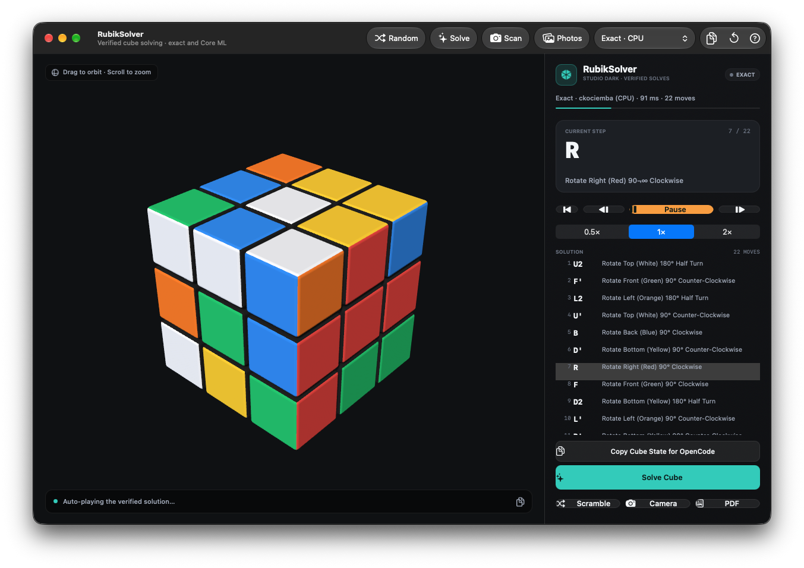

# RubikSolver

A native macOS Rubik's Cube solver with camera and photo input, an interactive 3D cube, verified solutions, and optional Core ML guidance.



RubikSolver turns a real 3x3 cube into a step-by-step solution. Scan the six faces with a webcam, upload photos, or generate a scramble, then solve with the exact CPU engine, a Core ML beam search, or a hybrid of both. Every solution is replayed and checked before it is shown.

The same validated core powers the macOS app, the `rubik-cli` command-line tool, and the OpenCode plugin.

---

## Contents

- [Features](#features)
- [Requirements](#requirements)
- [Build and run](#build-and-run)
- [Using the app](#using-the-app)
- [How solving works](#how-solving-works)
- [Vision pipeline](#vision-pipeline)
- [Project structure](#project-structure)
- [rubik-cli](#rubik-cli)
- [OpenCode plugin](#opencode-plugin)
- [ML training pipeline](#ml-training-pipeline)
- [Tests](#tests)
- [Troubleshooting](#troubleshooting)

---

## Features

- **Live camera scanning** — capture all six faces with a 3x3 alignment overlay and automatic sticker recognition.
- **Six-face photo upload** — drag and drop one image per face, batch-import photos, or load the bundled sample cube.
- **Exact solver** — ckociemba's two-phase algorithm running on the CPU.
- **Core ML neural search** — a DeepCubeA-style value/policy network guiding a beam search on the GPU when available.
- **Hybrid fallback** — if the neural search cannot finish in time, the exact solver completes the cube.
- **Full validation** — invalid states are rejected with a specific reason such as `edge-flip`, `corner-twist`, or `parity`.
- **Verified solutions** — returned moves are replayed before success is reported.
- **Interactive 3D cube** — orbit, zoom, and animated layer turns.
- **Step-by-step dashboard** — next/previous, autoplay, speed control, and a clickable move list.
- **PDF export** — an illustrated solution manual with the initial cube net and move-by-move cards.
- **Random scramble generator** — toolbar scramble or the `Actions → Random Cube & Solve` flow.
- **CLI and agent integration** — a standalone `rubik-cli` and OpenCode tools for solve, verify, and orient.

---

## Requirements

| Requirement | Notes |
|---|---|
| **macOS 14.0+** | The app, Core ML model, and project deployment target require macOS 14. |
| **Xcode 15+** | To build and run the app and Xcode tests. |
| **XcodeGen** | Only needed when regenerating the project from `project.yml`. The `.xcodeproj` is checked in. |
| **Xcode Command Line Tools** | Required by `scripts/build-cli.sh` (clang, Foundation, CoreML, Metal). |
| **Node.js 22.6+** | Only for OpenCode plugin tests. |
| **Python 3.10+** | Optional; only for the ML training/export pipeline in `MLTraining/`. |

Apple Silicon is recommended for the Core ML path. The exact solver, app UI, scanner, and CLI also work on Intel Macs running macOS 14.

---

## Build and run

The Xcode project is already checked in. Open it and run the `RubikSolver` scheme:

```bash
open RubikSolver.xcodeproj
```

Or build from the command line:

```bash
xcodebuild -project RubikSolver.xcodeproj \
           -scheme RubikSolver \
           -configuration Debug \
           build
```

If you change `project.yml` (targets, resources, build settings), regenerate the project:

```bash
brew install xcodegen   # once
xcodegen generate
```

On first use of the camera scanner, macOS asks for camera permission. The app declares `NSCameraUsageDescription` in `RubikSolver/App/Info.plist`. If permission was denied, re-enable it in **System Settings → Privacy & Security → Camera**.

---

## Using the app

### Scan with the camera

1. Click **Scan** in the toolbar, or press `⌘⇧K`.
2. Hold the cube inside the on-screen 3x3 alignment guide.
3. Confirm the detected colors, then capture each of the six faces.
4. Correct any sticker by tapping its square if recognition is uncertain.
5. Apply the scan and solve.

The overlay guides you through the faces in the usual order (Top/white, Right/red, Front/green, Down/yellow, Left/orange, Back/blue). Each face is identified by its center sticker, and the scan session keeps the six faces together for validation and orientation recovery.

### Upload six face photos

1. Click **Photos**, or press `⌘U`.
2. Drop one image per face, use **Import Photos** to select several at once, or click **Load Sample Photos**.
3. Faces are auto-assigned by their center sticker color. Any sticker can be corrected, and the ROI can be adjusted.
4. Click **Apply & Solve**.

The bundled `SampleImages/` folder contains a complete six-face sample and a scrambled overview. It backs the photo-recognition tests and the UI test that solves the sample cube end to end. See [`SampleImages/README.md`](SampleImages/README.md).

### Generate a scramble

- **Toolbar Random** applies a random 22-move scramble. It does **not** start a solve.
- **Actions → Random Cube & Solve** (`⌘R`) scrambles and solves in one step.
- **Actions → Generate Random Cube...** opens the scramble generator sheet, where the move count can be selected.

### Solve and step through

1. Choose **Exact**, **Neural**, or **Hybrid** in the toolbar engine selector.
2. Click **Solve** or press `⌘S`.
3. Use **Next** / **Prev** to move through the solution, or **Play** to autoplay. Speed can be set to 0.5x, 1x, or 2x.
4. Click any row in the solution list to jump to that move.

The 3D view supports drag-to-orbit and scroll/pinch-to-zoom. Press `⌘0`, Space, `C`, or double-click the viewport to recenter the camera.

### Export a PDF guide

Click **PDF** at the bottom of the step panel. The generated manual includes the initial scramble, the unfolded cube net, the full move sequence, and illustrated step cards. It opens in Preview after export.

### Other shortcuts

| Shortcut | Action |
|---|---|
| `⌘U` | Upload cube face photos |
| `⌘S` | Solve the current cube |
| `⌘R` | Random cube and solve |
| `⌘.` | Stop the solver |
| `⌘⇧K` | Open/close the camera scanner |
| `⌘⇧C` | Copy the current cube state for OpenCode |
| `⌘K` | Reset the cube to solved |
| `⌘0` | Center the 3D camera |
| `⌘?` | Open the in-app help |

---

## How solving works

### 1. State representation

A cube is stored as **54 facelets** in `U R F D L B` face order, each face row-major:

```
UUUUUUUUU RRRRRRRRR FFFFFFFFF DDDDDDDDD LLLLLLLLL BBBBBBBBB
```

The 18 supported moves are the standard Singmaster moves:

```
U U' U2   R R' R2   F F' F2
D D' D2   L L' L2   B B' B2
```

Before solving, the state is checked for:

- exactly nine stickers of each of the six colors,
- correct center colors,
- valid edge and corner pieces,
- flipped edges and twisted corners,
- matching permutation parity.

If any check fails, the solve is refused. The CLI reports the specific validation code and exits with status `3`.

### 2. Exact engine

The default engine is the exact two-phase solver from ckociemba (`RubikSolver/RubikCore/ckociemba`).

- Runs on the CPU.
- Uses pruning tables cached in `~/Library/Application Support/RubikSolver/ckociemba-cache`.
- Serializes solves through a mutex; a second solve returns `Busy`.
- Supports cancellation and a timeout.
- Simplifies redundant moves after solving.
- Replays the returned sequence and verifies the cube is solved before reporting success.

In the app, the exact engine uses a 30-second timeout and a maximum depth of 24.

### 3. Neural engine

The neural path is an optional accelerator and research component, not the only solver. It uses the bundled `DeepCubeA.mlmodelc`.

**Input encoding**

Each facelet is one-hot encoded across six colors, producing a `324`-element vector. The model consumes a fixed `[512, 324]` Float32 batch; smaller batches are zero-padded. The fixed shape is what keeps Core ML on the GPU.

**Network topology**

```
cube_state [512, 324]
    → Linear 324→1024 + ReLU
    → Residual block 1: Linear 1024→1024 + ReLU
                        Linear 1024→1024
                        Add skip connection + ReLU
    → Residual block 2: Linear 1024→1024 + ReLU
                        Linear 1024→1024
                        Add skip connection + ReLU
    ├→ Value head: Linear 1024→1      (cost-to-go)
    └→ Policy head: Linear 1024→18    (move logits)
```

The compiled model has seven linear layers, five ReLUs, two residual additions, and about 4.55M parameters. It stores weights and outputs in Float16.

**Runtime**

- Loaded with `MLComputeUnitsCPUAndGPU`, not `MLComputeUnitsAll`.
- Uses low-precision accumulation on the GPU.
- Verifies actual GPU placement through `MLComputePlan` on macOS 14.4+.
- Runs a beam search with defaults of beam width 512, depth 30, 200,000 nodes, and a 4-second budget.
- Scores candidates by `value - 0.25 × policyLogit`.
- Replays and verifies any solution before returning it.

**Fallback**

If Core ML is unavailable, the model fails to load, the search times out, or the search exhausts its depth budget, the exact engine takes over. The UI labels this result **Neural · exact fallback** or **Hybrid · exact fallback**.

The checked-in checkpoint is a compact demo model. Deeper scrambles rely on the exact fallback more often than a fully trained DeepCubeA network would. That is expected behavior, not a validation failure.

### 4. Hybrid mode

Hybrid mode runs the neural search first and automatically falls back to the exact solver. It is the best default when you want to try the model-guided path without giving up reliability.

---

## Vision pipeline

The scanner is a classical computer-vision pipeline, not a neural classifier.

1. **Frame acquisition** — `AVCaptureSession` requests 1280x720 `32BGRA` frames (falling back to the system high preset if that size is unavailable).
2. **ROI and grid** — the selected face is mapped to a normalized rectangle and divided into a 3x3 grid.
3. **Spatial sampling** — each cell is sampled in a circular neighborhood with radius `0.18 × min(cellWidth, cellHeight)`, avoiding the black plastic between stickers.
4. **Color space** — RGB is converted to CIELAB. Live camera frames also receive grey-world white balance; uploaded stills are analyzed without it to avoid biasing a red or yellow face.
5. **Classification** — each sticker is matched to the nearest of six CIELAB prototypes using Delta E distance. Confidence combines the margin to the second-best match and absolute closeness.
6. **Rejection** — very dark or low-chroma samples are treated as background instead of being forced into a color.
7. **Center calibration** — once the six centers are available, the prototypes are replaced by the actual center colors and every sticker is reclassified.
8. **Orientation recovery** — `RubikOrientation` tries all 4^6 in-plane face rotations and validates each candidate to find the canonical facelet layout.
9. **Manual correction** — any sticker can be changed before applying the state.

HSV threshold classification exists only as a diagnostic helper (`legacyHSVClassify`). The `train_color_classifier.py` script is an optional experiment and is not used by the app scanner.

---

## Project structure

| Path | Purpose |
|---|---|
| `RubikSolver/App/` | App delegate, menus, lifecycle, Info.plist |
| `RubikSolver/RubikCore/` | Cube model, validation, orientation recovery, exact engine, neural solver, Core ML wrapper |
| `RubikSolver/RubikVision/` | Camera capture, scan session, color math, classifier, overlay |
| `RubikSolver/RubikUI/` | Main window, 3D view, step panel, photo upload, random generator, help |
| `RubikSolver/RubikExport/` | Illustrated PDF exporter |
| `RubikSolver/Resources/` | `DeepCubeA.mlmodelc`, app icon |
| `SampleImages/` | Six-face sample photos and sample scramble |
| `MLTraining/` | PyTorch training, Core ML export, evaluation scripts |
| `tools/rubik-cli/` | Standalone verified solver |
| `.opencode/plugins/rubik-solver/` | OpenCode tools backed by `rubik-cli` |
| `Tests/` | Unit, UI, CLI, and plugin tests |
| `scripts/` | Build, test, and icon-generation scripts |
| `project.yml` | XcodeGen project definition |

`RubikCore` is built as a static library from the C++/Objective-C++ sources and shared by the app and CLI. The camera, photo-upload, 3D, and export layers sit above it and do not duplicate solver logic.

---

## rubik-cli

Build the standalone CLI without Xcode or DerivedData:

```bash
scripts/build-cli.sh
# output: build/rubik-cli/rubik-cli
```

The CLI links the same validation, orientation, exact solver, and Core ML facade as the app. Pruning tables are shared through the same Application Support cache.

### Commands

```bash
SOLVED=UUUUUUUUURRRRRRRRRFFFFFFFFFDDDDDDDDDLLLLLLLLLBBBBBBBBB

build/rubik-cli/rubik-cli verify --facelets "$SOLVED"

STATE=$(build/rubik-cli/rubik-cli state --scramble 20 --seed 42)
build/rubik-cli/rubik-cli solve --facelets "$STATE" --engine exact --json

build/rubik-cli/rubik-cli orient --facelets "$ROTATED" --json
```

`solve` accepts `--engine exact|neural|hybrid`, `--timeout`, `--neural-budget`, `--max-depth`, `--beam-width`, `--max-nodes`, and `--json`. `state` can apply a move list or generate a deterministic scramble from a seed.

Every returned solution is replayed and verified by default. Pass `--no-verify` only when you explicitly need to skip that check.

### Exit codes

| Code | Meaning |
|---|---|
| `0` | Success, valid cube, or already solved |
| `2` | Usage or argument error |
| `3` | Invalid cube state |
| `4` | No solution or solver failure |
| `5` | Timeout |
| `6` | Cancelled |
| `7` | Solver busy |
| `8` | Orientation failed |

See [`tools/rubik-cli/README.md`](tools/rubik-cli/README.md) for the full JSON schema and options.

---

## OpenCode plugin

`.opencode/plugins/rubik-solver/` registers three tools:

- `rubik_solve` — validate and solve a facelet string.
- `rubik_verify` — run the full cubie validation without solving.
- `rubik_orient` — recover in-plane face rotations.

The plugin builds `rubik-cli` on first use, calls it with an argument array (no shell interpolation), and forwards OpenCode's cancellation signal to the child process. Set `RUBIK_CLI=/path/to/rubik-cli` to use a custom binary.

Example prompt:

> Solve this cube: `UUUUUUUUURRRRRRRRRFFFFFFFFFDDDDDDDDDLLLLLLLLLBBBBBBBBB`

---

## ML training pipeline

`MLTraining/` contains the Python pipeline used to train and export the neural model.

### DeepCubeA and ADI

The network is trained with **Autodidactic Iteration (ADI)**. Training starts at the solved state, applies a random scramble of 1 to 30 moves, and evaluates all 18 successors with a target network:

- **Value target** — minimum one-step Bellman cost over the 18 moves.
- **Policy target** — the move that achieves that minimum, as a one-hot classification target.
- **Value loss** — Huber / Smooth L1.
- **Policy loss** — cross-entropy, weighted by `--policy-weight` (default `0.1`).
- **Optimizer** — AdamW with weight decay `1e-4`.
- **Learning rate** — cosine decay from `1e-3` to `1e-6`.
- **Defaults** — batch size 1000, max scramble 30, 5000 iterations, target-network sync every 100 iterations, gradient clipping at 1.0.

### Export to Core ML

```bash
cd MLTraining
python3 -m venv venv
source venv/bin/activate
pip install -r requirements.txt

python3 export_coreml.py \
    --checkpoint checkpoints/deepcubea_checkpoint.pt \
    --fixed-batch-size 512 \
    --install
```

The exporter traces the PyTorch model, converts it to a Float16 `MLProgram`, and installs `DeepCubeA.mlmodelc` into `RubikSolver/Resources/`. The fixed batch size is intentional: a static batch of 512 helps Core ML place the model on the GPU. The generated model targets macOS 14 / iOS 17 and exposes:

- input `cube_state`: `[512, 324]` Float32,
- output `value`: `[512, 1]` Float16,
- output `policy`: `[512, 18]` Float16.

See [`MLTraining/README.md`](MLTraining/README.md) for training commands, evaluation, and numerical-parity checks.

---

## Tests

```bash
scripts/test.sh unit      # Xcode unit tests
scripts/test.sh ui        # XCUITest suite
scripts/test.sh cli       # rubik-cli end-to-end tests
scripts/test.sh plugin    # OpenCode plugin tests
scripts/test.sh all       # everything
scripts/test.sh coverage  # unit tests with coverage
scripts/test.sh list      # list available Xcode tests
```

The test suite covers cube math, validation, the exact engine, orientation recovery, color math, scan sessions, the Core ML facade, the step panel, photo recognition, and the end-to-end sample-photo solve.

Regenerate the Xcode project first if `project.yml` changed:

```bash
xcodegen generate
```

---

## Troubleshooting

### The camera scanner does not open

Check **System Settings → Privacy & Security → Camera** and allow RubikSolver. Camera access is also required for the live scan session; photo upload works without it.

### The app reports “Core ML model is not loaded” or falls back to exact

- Confirm that `RubikSolver/Resources/DeepCubeA.mlmodelc` is included in the app bundle.
- Hybrid and Neural modes intentionally fall back to the exact solver, so a solved cube can still be returned with **exact fallback** in the status line.
- The bundled checkpoint is a compact demo model; deeper scrambles commonly need the fallback.

### The neural mode is not using the GPU

The app requests `CPUAndGPU` and verifies placement through `MLComputePlan`. On macOS versions before 14.4, the app cannot verify GPU placement and reports that limitation rather than claiming acceleration.

### The exact solver is slow on first run

ckociemba builds pruning tables the first time it solves and caches them in `~/Library/Application Support/RubikSolver/ckociemba-cache`. Later solves reuse the cache.

### The CLI is not found by the OpenCode plugin

Run `scripts/build-cli.sh`, or set `RUBIK_CLI` to the binary path. The plugin also builds the CLI automatically on first tool use when the build script is available.

---

## Credits

The exact solver is based on [ckociemba](https://github.com/hkociemba/RubiksCube-TwophaseSolver) by Herbert Kociemba. The neural architecture is inspired by DeepCubeA (McAleer et al., *Nature Machine Intelligence*, 2019). The app, vision pipeline, CLI, and training code are part of this repository.
